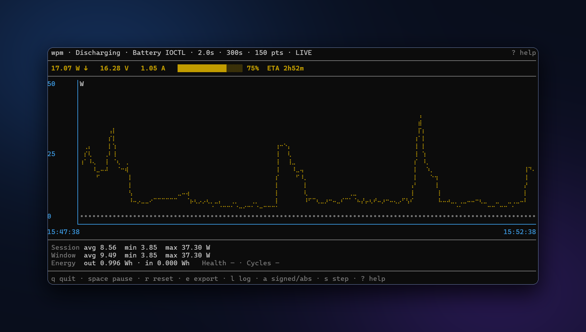

<div align="center">

# wpm · Windows Power Monitor

A lightweight, portable Windows terminal dashboard with a numeric tray icon, live charts, and simple exports.

**Windows 10/11 · x64 · Laptops**



</div>

## Features

- **Live dashboard.** Watts, voltage, current, battery percentage, remaining-time estimates, and a scrolling chart.
- **Watts in system tray.** A numeric notification-area icon keeps the current reading visible alongside the dashboard (Windows only).
- **Useful history.** Session/window statistics and separate charge/discharge energy totals.
- **Take the data with you.** Append CSV logs, export the displayed window to CSV + JSON, or stream NDJSON.

## Install

Requires **Windows 10 or 11 (x64)** and a supported laptop battery/driver for battery-flow readings. No Rust installation, separate runtime, service, or administrator elevation is required to run the portable executable; local security policies still apply.

**Portable builds are unsigned.** Winget distribution is planned. For now, build from source using the instructions below, or extract a supplied candidate ZIP into a writable folder after verifying its SHA-256 checksum.

### Linux

Laptops whose battery is exposed through `/sys/class/power_supply`. Readings come
from sysfs, so **no elevation, service, or extra runtime** is required.

```bash
cargo install --locked --path .            # installs ~/.cargo/bin/wpm
# or, from a verified candidate tarball:
./scripts/verify-package-linux.sh wpm-v<version>-linux-x64.tar.gz
tar -xzf wpm-v<version>-linux-x64.tar.gz
install -Dm755 wpm-v<version>-linux-x64/wpm ~/.local/bin/wpm
```

There is **no Linux system tray** (not implemented; `tray` defaults to `false`)
and no PDH-equivalent desktop power meter, so `--system-meter` only emits a
diagnostic. `wpm` is unrelated to the Python typing-speed tool of the same name,
which also installs to `~/.local/bin/wpm`; check `wpm --version` after installing.
`WPM_SYSFS_ROOT` overrides the sysfs directory (fixtures, containers, tests).

### macOS (experimental)

MacBook battery flow via the bundled `ioreg` tool. No menu-bar integration or
whole-system power measurement. Intel and Apple Silicon builds are intended;
real-hardware validation is pending. Missing telemetry stays unavailable and
remaining/full/design energy capacity is not reported.

```bash
cargo install --locked --path .
wpm --once
wpm --self-test
```

Building requires Rust stable and Xcode Command Line Tools. See
[macOS testing instructions](docs/dev/macos-install.md) and the
[implementation plan](docs/dev/macos-port-plan.md). Candidates are not Developer
ID signed or notarized; local security policies apply.

## Usage

Open PowerShell or Windows Terminal in the extracted folder:

```powershell
.\wpm.exe                                  # Dashboard + tray; samples every 5 seconds
.\wpm.exe --rate 2 --x-length 5m             # Two-second sampling, five-minute chart
.\wpm.exe --log .\battery.csv               # Dashboard with CSV logging
.\wpm.exe --once                            # One readable sample
.\wpm.exe --json                            # One JSON sample
.\wpm.exe --ndjson --rate 2                  # JSON stream; Ctrl+C to stop
.\wpm.exe --self-test                       # Provider diagnostics
```

Displays use magnitudes with direction shown separately. Use `--signed` for signed values; exports always use negative watts for discharge and positive for charge. `--tray=false` disables the tray. One-shot/stream modes do not open the dashboard or tray.

| Key | Action |
| --- | --- |
| `?` | Help and diagnostics |
| `Space` | Freeze/resume the display; sampling continues |
| `a` / `s` | Toggle magnitude/signed display / stepped chart |
| `r` | Reset history and session statistics |
| `e` / `l` | Export displayed window / toggle CSV logging |
| `q` | Quit |

## Configuration

Optional settings live in `%APPDATA%\wpm\config.toml` on Windows and
`$XDG_CONFIG_HOME/wpm/config.toml` (falling back to `~/.config/wpm/config.toml`)
on Linux and macOS:

```toml
rate = 5.0
x_length = 300
tray = true
theme = "default"
```

CLI options override `WPM_RATE`, `WPM_X_LENGTH`, and `WPM_THEME`, then the file and defaults. Use `--config` for another file and `--help` for options.

## Build from source

Requires **Rust stable (MSVC toolchain)**, **Visual Studio C++ Build Tools**, and the **Windows SDK**.

```powershell
git clone https://github.com/AnEvilBurrito/win_power_monitor.git
cd win_power_monitor
cargo build --locked --release --target x86_64-pc-windows-msvc
.\target\x86_64-pc-windows-msvc\release\wpm.exe
```

Desktop watts require specialized hardware and explicit verified meter selection; most desktops cannot report total system power.

On Linux only `rustup` is needed (no MSVC or Windows SDK; Windows crates are
behind `cfg(windows)` targets):

```bash
cargo build --locked --release
./target/release/wpm --once
```

## License

GNU GPL version 3 only (`GPL-3.0-only`). Binary redistribution requires matching complete Corresponding Source under GPLv3.
